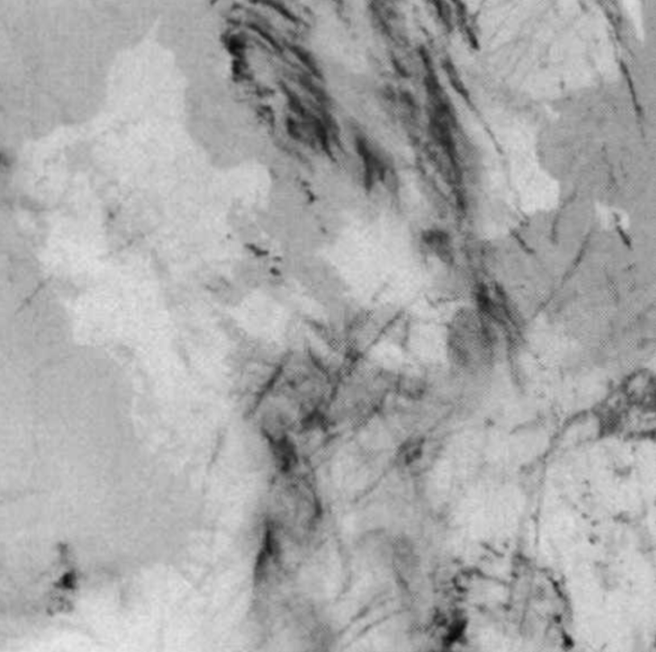

# Contrail Detection Demo

This repository demonstrates a simple approach for detecting linear contrails in satellite cloud imagery.  
It relies on directional convolution kernels similar to those described in
Mannstein, H., Meyer, R., & Wendling, P. (1999) *International Journal of Remote Sensing*.



## Overview

The code implements a multi-angle line detection algorithm that applies
directional convolution kernels to highlight linear features at different
orientations.  The demo can be run interactively via the provided notebook or as a
small Python script.

## Features

- Preprocess imagery with CLAHE and Gaussian blur
- Generate line kernels for many angles (0° – 165°)
- Combine responses from all angles to obtain a binary detection mask
- Visualise detections with an angle-coloured overlay

## Running the Demo

### Notebook

Open `muqy_20250310_contrail_course_detection_test.ipynb` in Jupyter and run
all cells.  The notebook shows each step of the algorithm and produces overlay
figures.

### Script

For a quick run you can execute:

```bash
python demo.py --show
```

This processes `contrail_showcase_1.png` and displays the resulting figures.
Use `python demo.py image_path` to run on a different image.

## Requirements

- numpy
- matplotlib
- scipy
- opencv-python
- scikit-image

Install dependencies with:

```bash
pip install -r requirements.txt
```

This repository is intended as a fun showcase of contrail detection with
minimal code.
